<div align="center">

# ReceiptLedger

**Turning physical receipt photos into structured, categorized spending intelligence.**

[](docs/course-materials/assignments/)
[](https://uok.edu.pk/)
[](docs/course-materials/lectures/)
[](docs/specifications/07_SPRINT_PLAN_3WEEKS.md)
[](docs/project-management/ReceiptLedger_SoW_v3.pdf)

<p align="center">
  
  
  
  
  
  
  
  
  
  
</p>

</div>

---

## Overview

Tracking cash expenditures across households and small businesses is hindered by loose, mixed receipts—ranging from printed supermarket invoices to informal handwritten corner-store (*kiryana*) slips. Manual ledger entry is friction-heavy and consistently abandoned.

**ReceiptLedger** provides an automated ingestion and analytics pipeline: photograph any physical receipt on mobile, extract line items and costs via specialized OCR paths, normalize merchant naming, classify items into local spending categories, and visualize monthly trends on an interactive dashboard.

---

## End-to-End Workflow

```mermaid
flowchart LR
    A["Paper Receipt<br/>(Printed / Handwritten)"] --> B["Mobile Capture &<br/>Edge Correction"]
    B --> C{"OCR Router"}
    C -->|"Printed Slip"| D1["Cloud Vision API /<br/>Tesseract"]
    C -->|"Handwritten Note"| D2["EasyOCR Engine &<br/>Binarization"]
    D1 --> E["Item Normalization &<br/>Fuzzy Matcher"]
    D2 --> E
    E --> F["Deduplication &<br/>Rule Categorizer"]
    F --> G[("PostgreSQL Ledger<br/>(Supabase)")]
    G --> H["Analytics Dashboard &<br/>Review Queue"]

    style A fill:#1E293B,stroke:#475569,stroke-width:1px,color:#F8FAFC
    style B fill:#0F766E,stroke:#14B8A6,stroke-width:1px,color:#F0FDFA
    style C fill:#1D4ED8,stroke:#3B82F6,stroke-width:1px,color:#EFF6FF
    style D1 fill:#4338CA,stroke:#6366F1,stroke-width:1px,color:#EEF2FF
    style D2 fill:#6D28D9,stroke:#8B5CF6,stroke-width:1px,color:#F5F3FF
    style E fill:#B45309,stroke:#F59E0B,stroke-width:1px,color:#FFFBEB
    style F fill:#047857,stroke:#10B981,stroke-width:1px,color:#ECFDF5
    style G fill:#334155,stroke:#64748B,stroke-width:1px,color:#F8FAFC
    style H fill:#0369A1,stroke:#0284C7,stroke-width:1px,color:#F0F9FF
```



---

## Core Capabilities

| Subsystem | Stack / Tool | Scope |
|:---|:---:|:---|
|  | Flutter | Single and batch receipt photo capture with edge preview and perspective deskewing. |
|  | Google Stitch | Interface wireframing, component mockups, and mobile UX design system. |
|  | Cloud Vision API / Tesseract | High-accuracy text and pricing extraction from structured retail register receipts. |
|  | EasyOCR + OpenCV | Character and numeric extraction tailored for informal small-shop receipts. |
|  | Levenshtein Matcher | Mapping colloquial names and local units into canonical retail items. |
|  | 64-bit pHash + SHA-256 | Preventing double-counting via visual hashing and metadata comparison. |
|  | Priority Rule Engine | Auto-sorting purchases into household spending categories (groceries, utilities, etc.). |
|  | React + Chart.js | Visualizing monthly spend, category distribution, and human-in-the-loop review queue. |

---

## Project Boundaries

### 
* **Mobile Ingestion:** Guided camera capture for single or multiple receipts.
* **Dual Text Extraction:** Separate processing pipelines for printed retail receipts and handwritten slips.
* **Item Standardization:** Canonical dictionary mapping for local product names and pack units.
* **Automated Categorization:** Rule-based tagging across common household expense categories.
* **Duplicate Detection:** Visual and textual validation against re-uploaded slips.
* **Spending Dashboard:**
  * Month-over-month expenditure comparison and variance tracking.
  * Category breakdown charts and multi-month spend velocity.
  * Filterable historical receipt ledger and item drill-down.
  * Review queue for verifying items with OCR confidence $< 0.85$.

### 
* Direct bank account integration or card statement reconciliation.
* Tax computation, GST filing, or legal invoice generation.
* Generic corporate categorization outside common consumer and retail goods.
* Training custom machine learning models from scratch.

---

## Repository Modules

| Module | Purpose | Stack |
|:---|:---|:---:|
| [`backend/`](backend/) | Core OCR routing, OpenCV deskewing, normalization, and API gateway | FastAPI • SQLite • EasyOCR • Gemini |
| [`mobile/`](mobile/) | Capture client, animated splash, auth login/signup, and ledger UI | Flutter • Dart • Material 3 |
| [`web/`](web/) | Desktop operations console, audit ledger, and human review desk | React 18 • TypeScript • Vite • Tailwind • Vercel |
| [`UI mockups/`](UI%20mockups/) | Design specifications, vector SVG icon tokens, and UI mockups | SVG • Figma Specs • PNG Wireframes |
| [`scripts/`](scripts/) | End-to-end stress tests, zero-cost HTTPS tunnels, and data tools | Python • PowerShell • Bash |
| [`docs/`](docs/) | Complete engineering specifications, IEEE 830 SRS, and course governance | Markdown • Mermaid |
| [`data/`](data/) | Sample receipt collection repository and local item taxonomy dictionary | Dataset • JSON |

---

## Zero-Cost Backend Setup & Tunneling (No Credit Cards)

The ReceiptLedger backend is fully functional with **zero server costs ($0.00/mo)** and requires **no credit card registration**.

### Option 1: 1-Click Free Public HTTPS Tunnel (Recommended)
Exposes your local backend to mobile devices or remote reviewers over a secure public HTTPS URL backed by Cloudflare's global edge or native OpenSSH Pinggy:
```bash
# Windows 1-Click:
run_tunneled_backend.bat

# Or via Python:
python scripts/devops/tunnel_server.py
```
- **Cost**: $0.00 / month forever.
- **Credit Card**: None required.
- Automatically generates a public HTTPS URL (`https://*.trycloudflare.com` or `https://*.a.pinggy.link`).
- Automatically updates `mobile/.env` with the active tunnel URL.

### Option 2: Localhost / LAN Server
```bash
# Windows 1-Click:
run_backend.bat

# Or manually:
cd backend
python -m uvicorn app.main:app --host 0.0.0.0 --port 8000 --reload
```
- Interactive Swagger API docs: `http://localhost:8000/docs`
- Health check: `http://localhost:8000/api/v1/health`

### Option 3: Free Cloud Hosting (Zero Credit Card)
- **Hugging Face Spaces (Docker/FastAPI)**: 100% Free with 16 GB RAM and persistent HTTPS URL without entering a credit card.
- **Render.com Free Web Service**: Standard Free Tier web service using GitHub OAuth without requiring credit card details.

---

## Deploying Web Dashboard to Vercel (1-Click Ready)

The `web/` operations dashboard is pre-configured for direct Vercel deployment with SPA route rewrites:

1. Import **`Asad101001/ReceiptLedger`** into [Vercel](https://vercel.com).
2. Set **Root Directory** to `web` *(Vercel auto-detects `Vite`)*.
3. In **Environment Variables**, set:
   * `VITE_API_BASE_URL`: Your backend URL (e.g. `https://<tunnel-url>.trycloudflare.com/api/v1` or production API).
4. Click **Deploy**. Vercel will build and host the dashboard on a global HTTPS CDN:
   * Production URL: [https://receiptledger-web.vercel.app](https://receiptledger-web.vercel.app)
   * Alternate URL: [https://receiptledger-app.vercel.app](https://receiptledger-app.vercel.app)

---

## Documentation

Master documentation index and governance deliverables are cataloged in [`docs/README.md`](docs/README.md).

### Core Specifications Suite ([`docs/specifications/`](docs/specifications/))

| Document | Summary |
|:---|:---|
| [**PRD**](docs/specifications/01_PRD.md) | Vision, target personas, and functional priority matrix |
| [**SRS**](docs/specifications/02_SRS.md) | IEEE 830 functional/non-functional requirements and API schemas |
| [**SDS**](docs/specifications/03_SDS.md) | Subsystem architecture, pipeline routing, and sequence flows |
| [**DFD**](docs/specifications/04_DFD.md) | Level 0 Context Model and Level 1 Functional Decomposition |
| [**ERD**](docs/specifications/05_ERD.md) | 3NF relational database schema and PostgreSQL/Supabase DDL |
| [**Semantic Networks**](docs/specifications/06_SEMANTIC_NETS.md) | Domain knowledge graphs, local item taxonomies, and unit hierarchies |
| [**3-Week Sprint Plan**](docs/specifications/07_SPRINT_PLAN_3WEEKS.md) | Compressed sprint timeline, backlog tickets, and exit criteria |
| [**Environment Setup**](docs/specifications/08_ENVIRONMENT_SETUP.md) | Prerequisites, local virtualenv, Node, Flutter, and Docker setup |
| [**Development Plan**](docs/specifications/09_DEVELOPMENT_PLAN.md) | In-depth engineering implementation roadmap and algorithmic specs |
| [**Division of Work**](docs/specifications/10_DIVISION_OF_WORK.md) | Official 6-role allocations, responsibilities, and pairing streams |

### Engineering Guides, Reports & UI/UX Briefs

| Document | Summary | Artifacts |
|:---|:---|:---:|
| [**Adversarial Stress Test Report**](docs/reports/VIGOROUS_BACKEND_STRESS_TEST_REPORT.md) | 28 boundary stress vectors, 100% pass rate, security audits & 6 mitigations | Markdown |
| [**Backend Operations Guide**](docs/guides/BACKEND_SETUP_AND_OPERATIONS_GUIDE.md) | Cloud Vision, Supabase, Tesseract setup, test suite & cURL reference | Markdown |
| [**Dashboard Integration Guide**](docs/guides/DASHBOARD_BACKEND_INTEGRATION.md) | Monorepo API wiring, CORS rules, and development server guide | Markdown |
| [**Mobile UI/UX Design Brief**](docs/design/MOBILE_DESIGN_BRIEF.md) | Stitch prompts, mobile screen wireframes, themes & design rules | [PDF](docs/design/ReceiptLedger_UI_UX_Design_Brief.pdf) |
| [**Dashboard Design Brief**](docs/design/DASHBOARD_DESIGN_BRIEF.md) | Desktop triage desk layout, keyboard ergonomics, API schemas | [PDF](docs/design/ReceiptLedger_Dashboard_Design_Brief.pdf) |

---

## Automated CI/CD & Android Release

Every commit to `main` executes an automated quality gate and builds the production Android APK using GitHub Actions:
* **Workflow**: [`.github/workflows/build-and-release.yml`](.github/workflows/build-and-release.yml) (Runs `flutter test`, `flutter analyze`, and builds release binary).
* **Direct Download**: Sideloadable [**`ReceiptLedger-v1.0.0-release.apk`**](ReceiptLedger-v1.0.0-release.apk) ready for physical device testing.


---

## Project Team

<div align="center">
<table>
  <tr>
    <td align="center" width="33%"><a href="https://github.com/Aazmeer30"></a></td>
    <td align="center" width="33%"><a href="https://github.com/Arish026"></a></td>
    <td align="center" width="33%"><a href="https://github.com/Imanh728"></a></td>
  </tr>
  <tr>
    <td align="center"><a href="https://github.com/Aazmeer30"><b>Aazmeer Sarfaraz Faridy</b></a></td>
    <td align="center"><a href="https://github.com/Arish026"><b>Arish Ahmed Khan</b></a></td>
    <td align="center"><a href="https://github.com/Imanh728"><b>Iman Hussain</b></a></td>
  </tr>
  <tr>
    <td align="center"><a href="https://github.com/Aazmeer30"></a><br/><sub><b>UI/UX Designer</b></sub></td>
    <td align="center"><a href="https://github.com/Arish026"></a><br/><sub><b>Risk Management Lead</b></sub></td>
    <td align="center"><a href="https://github.com/Imanh728"></a><br/><sub><b>Web Dashboard Developer</b></sub></td>
  </tr>
  <tr>
    <td align="center" width="33%"><a href="https://github.com/Asad101001"></a></td>
    <td align="center" width="33%"><a href="https://github.com/Aun2005"></a></td>
    <td align="center" width="33%"><a href="https://github.com/zainab251251"></a></td>
  </tr>
  <tr>
    <td align="center"><a href="https://github.com/Asad101001"><b>Muhammad Asad Khan</b></a></td>
    <td align="center"><a href="https://github.com/Aun2005"><b>Syed Aun Shamsi</b></a></td>
    <td align="center"><a href="https://github.com/zainab251251"><b>Zainab Hashmi</b></a></td>
  </tr>
  <tr>
    <td align="center"><a href="https://github.com/Asad101001"></a><br/><sub><b>Lead Architect & Core Backend</b></sub></td>
    <td align="center"><a href="https://github.com/Aun2005"></a><br/><sub><b>Project Manager (PM) & QA Lead</b></sub></td>
    <td align="center"><a href="https://github.com/zainab251251"></a><br/><sub><b>Data Collection & Ground Truth</b></sub></td>
  </tr>
</table>
</div>

---

<div align="center">
  <sub>Software Project Management (SPM-458) • Department of Computer Science • University of Karachi</sub>
</div>
